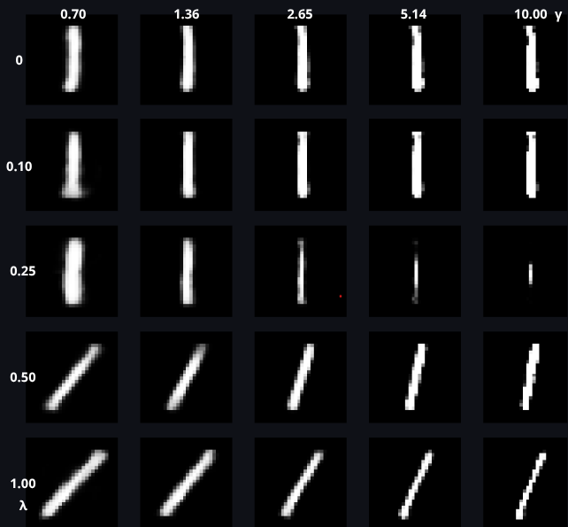
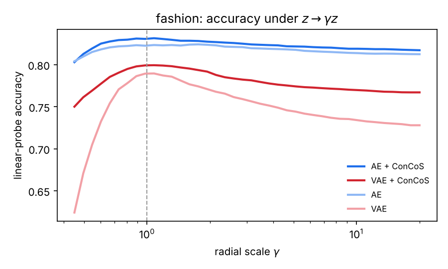

# ConCoS: Contrastive Cosine Similarity

Code for **[Learning Interpretable Generative Manifolds through Contrastive Cosine Similarity](paper/ConCoS.pdf)** (Nick van Kemenade, 2026).

ConCoS is a loss term you can add to any encoder–decoder. It organises the **direction** of each latent vector by class and leaves its **magnitude** free. The reconstruction loss then uses the magnitude for within-class variation, so the latent space splits along polar lines: *angle = what it is, radius = how it looks*.

<p align="center"></p>
<p align="center"><sub>MNIST VAE: decoding γ·z for one digit. The columns scale the magnitude γ and the rows increase the ConCoS weight λ. The identity holds across each row, while the style changes.</sub></p>

## The loss

For a batch of latents $z_i$ with labels $y_i$:

```math
\mathcal{L}_{\text{ConCoS}} = -\frac{1}{B(B-1)} \sum_i \sum_{j \neq i} \sigma(y_i, y_j)\,\frac{z_i \cdot z_j}{\lVert z_i\rVert\,\lVert z_j\rVert},
\qquad \sigma(y_i, y_j) = \begin{cases} +1 & y_i = y_j \\ -1 & y_i \neq y_j \end{cases}
```

Cosine similarity doesn't change when a vector is multiplied by $\gamma > 0$, so ConCoS has no effect on $\lVert z\rVert$. No temperature, augmentations or projection head are needed. The whole loss is one matrix product ([`concos/loss.py`](concos/loss.py)):

```python
from concos import concos_loss

loss = recon_loss + 0.5 * concos_loss(z, labels)          # AE
loss = recon_loss + 0.5 * concos_loss(mu, labels) + 1e-3 * kl   # VAE: ConCoS acts on the posterior mean
```

`concos_from_critic(z, critic)` implements the generalised form (Eq. 7). In that form the ±1 label matrix is replaced by any pairwise similarity in [−1, 1], for example cosine similarities from a frozen pretrained encoder (`teacher_critic`).

## Results

The paper tests 12 models (AE / VAE, with and without ConCoS, on MNIST, Fashion-MNIST and EMNIST Letters) against three hypotheses:

| Hypothesis | Metric | Plain VAE (MNIST) | VAE + ConCoS (MNIST) |
|---|---|---|---|
| **H1** Direction encodes class | intra − inter class cosine gap | 0.575 | **1.073** |
| **H2** Class survives rescaling | probe accuracy range over γ ∈ [0.5, 10] | 0.089 | **0.021** |
| **H3** Magnitude encodes within-class variation | radial feature distance ↑ / MI(‖z‖, class) ↓ | 1.438 / 0.214 | **4.514 / 0.063** |

The ConCoS models' inter-class cosine converges to about **−1/(C−1)**: −0.111 for 10 classes and −0.04 for 26. This is the lowest value C directions on a sphere can reach, so the class means end up arranged as a regular simplex.

Full tables are in the paper. Output of `reproduce.py` on Fashion-MNIST (20 epochs, CPU, single seed):

| Model | Intra cos | Inter cos | Gap | Acc γ=0.5 / 1 / 10 | Radial feat. dist ↑ | MI(r, class) ↓ |
|---|---|---|---|---|---|---|
| AE + ConCoS | 0.980 | **−0.111** | **1.091** | 0.813 / 0.831 / 0.819 | 2.348 | 0.289 |
| VAE + ConCoS | 0.970 | **−0.111** | **1.081** | 0.762 / 0.799 / 0.770 | 3.361 | 0.038 |
| AE | 0.693 | 0.231 | 0.462 | 0.810 / 0.822 / 0.814 | 1.912 | 0.112 |
| VAE | 0.599 | −0.082 | 0.680 | 0.674 / 0.789 / 0.734 | 2.574 | 0.040 |

H1 reproduces exactly: both ConCoS models reach the 10-class simplex bound (−0.111). The VAE results for H2 and H3 also hold. In this single-seed run, though, the plain AE is almost as scale-invariant as AE + ConCoS, and AE + ConCoS has a *higher* MI(r, class) than its baseline. Multi-seed runs are on the to-do list.

<p align="center"></p>

## Reproduce

```bash
pip install -r requirements.txt
python reproduce.py                                 # all 12 models, about 15 min per dataset on CPU
python reproduce.py --datasets fashion --epochs 5   # quick check
```

This writes `results/results.md` (Tables 1–3), `results/results.json`, and figures for each dataset: the radial-invariance curve (Fig. 8), the cosine distributions (Fig. 7) and the radial sweep (Fig. 1/9). Datasets download automatically. To use local copies, pass `--data-root DIR` with `DIR/<dataset>/` holding the IDX `.gz` files.

Defaults follow the paper: latent dim 32, λ = 0.5, β = 1e-3, Adam, batch size 128, 20 epochs.

## Layout

```
concos/loss.py      ConCoS loss (supervised + generalised critic form)
concos/models.py    dense AE / VAE with the combined objective
concos/data.py      MNIST, Fashion-MNIST, EMNIST Letters loaders
concos/metrics.py   H1–H3 metrics
reproduce.py        train the 4 variants per dataset, write tables + figures
paper/ConCoS.pdf    the paper
assets/             README figures
```

## Citation

```bibtex
@article{vankemenade2026concos,
  title  = {Learning Interpretable Generative Manifolds through Contrastive Cosine Similarity},
  author = {van Kemenade, Nick},
  year   = {2026}
}
```
